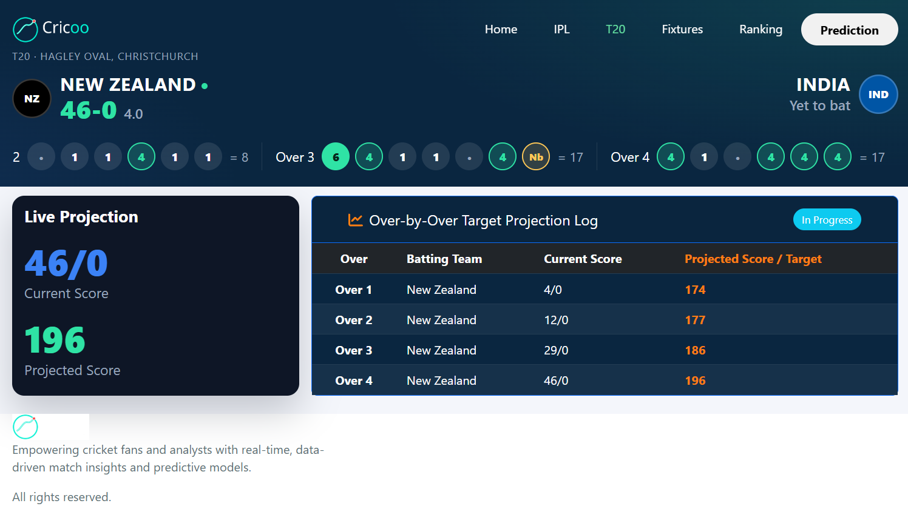
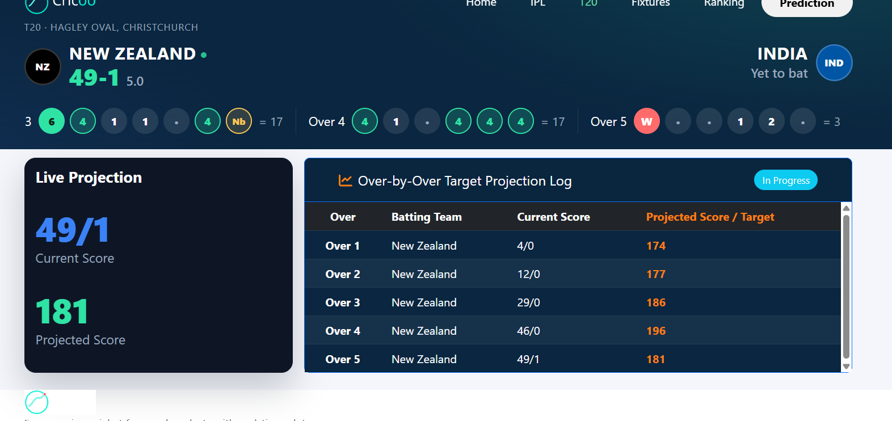
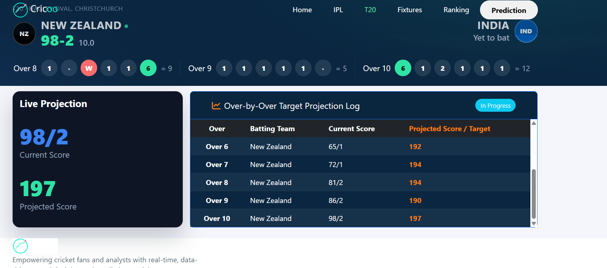
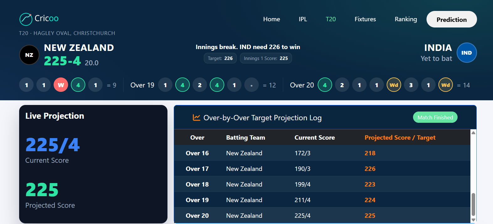

<div align="center">

# Cricoo

**Live cricket predictions for the IPL and T20 internationals, powered by machine learning.**

Final-score projections in the first innings. Win probability in the chase. Updated over by over.

[**T20 Live**](https://steverogers12-7.github.io/cricoo/public/t_20.html) &nbsp;|&nbsp; [**IPL Live**](https://steverogers12-7.github.io/cricoo/public/ipl.html)

</div>

---

## What is Cricoo?

Cricoo is a live match-prediction platform for cricket. It follows a match as it happens, feeds the over-by-over data into trained ML models, and shows fans three things:

| Phase | What you get | Model |
|---|---|---|
| **Before the match** | Projected first-innings total from the playing XI, venue and recent form | Pre-match score predictor |
| **Innings 1** | Live projected final score, refreshed after every over | In-play target projection |
| **Innings 2 (chase)** | Win probability as a percentage that shifts with every over | Chase win-probability model |

The platform currently focuses on two products:

- **IPL platform** with all three models.
- **T20 platform** for men's T20 internationals, with the in-play first-innings projection.

---

## live site

Live T20 page during a T20I at Hagley Oval, Christchurch (New Zealand batting first).

<table>
  <tr>
    <td align="center"><br /><sub><b>Over 4:</b> 46/0, projected 196</sub></td>
    <td align="center"><br /><sub><b>Over 5:</b> a wicket falls and the projection drops to 181</sub></td>
  </tr>
  <tr>
    <td align="center"><br /><sub><b>Over 10:</b> 98/2, projected 197</sub></td>
    <td align="center"><br /><sub><b>Innings break:</b> 225/4, target set at 226</sub></td>
  </tr>
</table>

---

## Features

- **Live ball-by-ball strip.** Every over shows each delivery (dots, singles, fours, sixes, wickets, wides, no-balls) with the over total.
- **Over-by-over projection log.** A table of the score and the model's projected total after each completed over, so you can see how the projection moves with the match.
- **Win probability in the chase.** Shown as a percentage for both teams, not a yes/no.
- **Prediction range.** The T20 model builds an 80% range from the model's own historical errors, per over.
- **Fully automatic.** The backend finds the next match, starts about 28 minutes before the toss, waits for the toss and playing XI, then updates every over. The page switches between pre-match, innings 1, innings break, innings 2 and result by itself.
- **API-quota aware.** The poller is built to stay inside a daily call limit, and visitors never trigger upstream API calls.
- **Demo mode.** Add `?demo=1` to the page URL to replay a simulated match with Prev / Play / Next controls.
- **Responsive.** Works on phones, tablets and desktops.

---

## How it works

```
 Cricket Live Line API (RapidAPI)
              |
              v
   Poller  (1 background thread, quota guard)
              |   over-by-over history
              v
   Tracker + Engine  (feature building, ML models)
              |
              v
   Flask API   /api/t20/live    /api/ipl/live    /health
              |
              v
   Static site (GitHub Pages)  -->  polls every 60 s and renders the live page
```

### Models

| Platform | Model | Details |
|---|---|---|
| IPL | Pre-match score predictor | LightGBM, player-level expected runs scaled to a team total, plus a venue/era baseline and a prediction interval |
| IPL | In-play projection | Updates the projected total over by over from score, wickets and run rate |
| IPL | Chase win probability | Logistic regression and gradient-boosting blend, calibrated with Platt scaling |
| T20 | In-play projection (innings 1) | XGBoost model that predicts the **remaining runs**, added to the current score. An empirical 10th to 90th percentile band per over comes from the model's errors on a 2025-26 test set |

For the first few overs of a T20 innings the shown projection gets a small configurable correction (`EARLY_ADD` over the first `EARLY_OVERS` overs). The raw model output is always kept alongside it.

---

## Tech stack

| Layer | Tools |
|---|---|
| Frontend | HTML, CSS, JavaScript, Bootstrap 5, Pug, SCSS, Gulp |
| Backend | Python, Flask, Gunicorn |
| ML | LightGBM, XGBoost, scikit-learn, pandas, NumPy |
| Data | RapidAPI Cricket Live Line |
| Hosting | GitHub Pages (site), Render (backends) |

---

## Project structure

```
cricoo/
├── public/                  # Live site (index, ipl.html, t_20.html, blogs)
│   └── assets/
│       ├── css/             # ipl.css, t_20.css, theme files
│       ├── img/             # logos, cards and the README screenshots
│       └── js/              # ipl-live.js, t20-live.js
├── src/                     # Pug / SCSS / JS sources for the site
├── cricoo_backend/          # IPL backend (Flask app, 3 model bundles, poller, tests)
├── t20_backend/             # T20 backend (Flask app, XGBoost model, bands, poller, tests)
├── gulp/ , gulpfile.js      # Site build tasks
└── README.md
```

---

## Getting started

### 1. Run the T20 backend locally

```bash
cd t20_backend
pip install -r requirements.txt

# run the tests (should end with: ALL T20 TESTS PASSED)
python test_t20.py

# fake match for a quick try (no API key needed)
MODE=mock MOCK_SPEED=20 python -m flask --app t20_app run --port 5000
```

Then open `http://127.0.0.1:5000/api/t20/live` and `http://127.0.0.1:5000/health`.
On Windows, use `set MODE=mock` and `set MOCK_SPEED=20` on separate lines.

### 2. Run the IPL backend locally

```bash
cd cricoo_backend/cricoo_backend
pip install -r requirements.txt
MODE=mock MOCK_SPEED=20 python -m flask --app app run --port 5001
```

### 3. Go live

```bash
export RAPID_KEY=<your RapidAPI key>
gunicorn -w 1 --threads 4 -b 0.0.0.0:$PORT t20_app:app
```

Use **one worker only**, so there is exactly one poller. A `Procfile` and a Render `render.yaml` blueprint are included in `t20_backend/`. Run the IPL and T20 backends as separate services; each keeps its own daily call counter.

On the free Render plan the service sleeps when idle, so ping `/health` every 5 minutes with a free uptime monitor to keep the poller running.

### 4. Build the website

```bash
npm install
npm start          # dev server with live reload
npm run build      # production build
```

### Environment variables (T20 backend)

| Variable | Purpose | Default |
|---|---|---|
| `RAPID_KEY` | RapidAPI key | required |
| `DAILY_LIMIT` | Max API calls per day | `95` |
| `EARLY_ADD` | Runs added to the projection in the early overs | `20` |
| `EARLY_OVERS` | Number of early overs the addition applies to | `5` |
| `T20_MODEL` | Path to the model `.pkl` | `models/inplay_t20_v2.pkl` |
| `ALLOWED_ORIGIN` | CORS origin for your site | `*` |
| `SERIES_FILTER`, `EXCLUDE_SERIES`, `MATCH_TYPE` | Which matches to follow | all men's T20 |
| `FORCE_MATCH_ID`, `FORCE_START`, `FORCE_TEAMS` | Manually pin a match | unset |


---

## Roadmap

- [ ] Improve the IPL and T20 models with more data, better features and stronger validation
- [ ] Add second-innings win probability to the T20 platform
- [ ] Expand coverage to more T20 leagues and match formats
- [ ] Player comparison (head to head)
- [ ] Better calibration and a clearer view of model accuracy on the site

---

## Author

**Ashutosh Kumar**</br>
2024UCM2304</br>
B.Tech (Mathematics & computing)</br>
Netaji Subhas University of Technology (NSUT), Delhi
